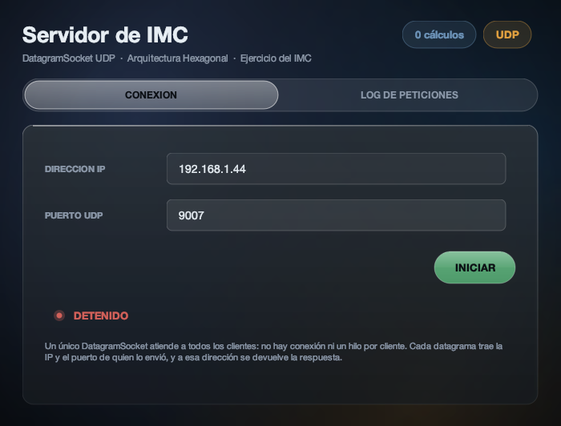
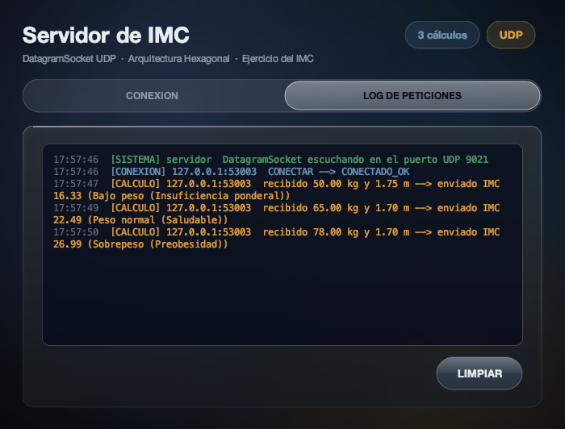
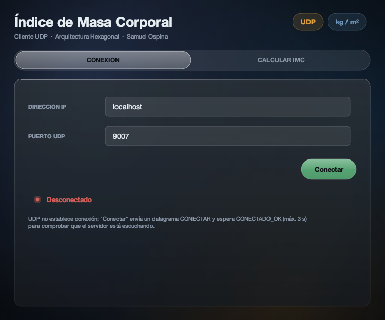
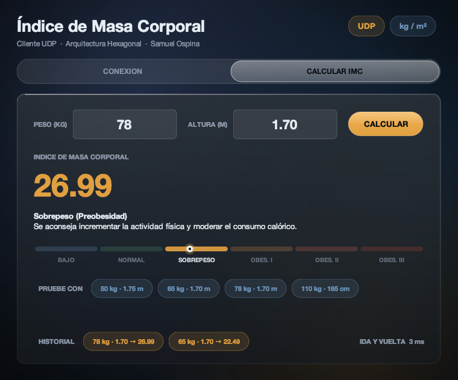

# Cálculo del IMC con UDP/IP y Arquitectura Hexagonal

Autor: **Samuel David Ospina de Ávila** · Unicolombo · Sistemas Distribuidos, 2º corte

Es el ejercicio del profesor (calcular el **Índice de Masa Corporal**), hecho con:

- **UDP/IP** (`DatagramSocket` / `DatagramPacket`) en lugar de TCP (`ServerSocket` / `Socket`).
- **Arquitectura Hexagonal** (puertos y adaptadores), con la misma estructura de los repositorios
  guía [`imc-udp-server`](https://github.com/arrietajohn/imc-udp-server) e
  [`imc-udp-client`](https://github.com/arrietajohn/imc-udp-client).

Mi ejercicio de parcial (conversión de temperatura) con esta misma tecnología está en
[temperatura-udp-java-hexagonal](https://github.com/SamuelOsp/temperatura-udp-java-hexagonal).

La fórmula `IMC = peso / altura²` y los rangos están **solo** en el dominio del servidor
(`dominio/modelos/Calculo.java` y `dominio/enums/ClasificacionImc.java`). El cliente valida los
datos, los envía y muestra la respuesta.

## Vistas

| Servidor escuchando | Log de peticiones |
|---|---|
|  |  |
| **Cliente** | **Cliente calculando** |
|  |  |

## Cómo ejecutar

Requisito: **Java 17 o superior**. No hace falta instalar Maven porque cada proyecto trae el Maven Wrapper (`mvnw`).

```bash
# Terminal 1: servidor
cd imc-udp-server
./mvnw package            # compila y corre las pruebas
java -jar target/imc-udp-server.jar

# Terminal 2: cliente
cd imc-udp-client
./mvnw package
java -jar target/imc-udp-client.jar
```

En Windows se usa `mvnw.cmd package`. En el servidor presione **INICIAR** (puerto 9007). En el
cliente presione **Conectar** (`localhost`, `9007`), escriba el peso y la altura y **CALCULAR**.

## Protocolo (texto UTF-8, un datagrama por mensaje)

Es el mismo del repositorio guía, así que este cliente también funciona contra el servidor del
profesor.

| Cliente envía | Servidor responde |
|---|---|
| `CONECTAR` | `CONECTADO_OK;Servidor UDP listo para calcular IMC` |
| `CALCULAR;78.00;1.70` | `OK_CALCULO;26.99;Sobrepeso (Preobesidad);Se aconseja incrementar la actividad física y moderar el consumo calórico.` |
| `CALCULAR;0;1.70` | `ERROR;Peso incorrecto: debe ser mayor que 0` |
| `DESCONECTAR` | `DESCONECTADO_OK;Sesión finalizada` |

## Reglas del dominio

| IMC | Clasificación |
|---|---|
| menor que 18.5 | Bajo peso (Insuficiencia ponderal) |
| 18.5 a menos de 25 | Peso normal (Saludable) |
| 25 a menos de 30 | Sobrepeso (Preobesidad) |
| 30 a menos de 35 | Obesidad Grado I (Moderada) |
| 35 a menos de 40 | Obesidad Grado II (Severa) |
| 40 o más | Obesidad Grado III (Mórbida) |

- `Peso` y `Altura` son *value objects*: rechazan valores no finitos o menores o iguales a 0.
- Una altura mayor que 3 se interpreta en **centímetros** (`170` equivale a `1.70`), como en el
  repositorio guía.

| Peso (kg) | Altura | IMC | Clasificación |
|---|---|---|---|
| `50` | `1.75` | `16.33` | Bajo peso |
| `65` | `1.70` | `22.49` | Peso normal |
| `78` | `1.70` o `170` | `26.99` | Sobrepeso |
| `95` | `1.70` | `32.87` | Obesidad Grado I |
| `110` | `1.70` | `38.06` | Obesidad Grado II |
| `130` | `1.70` | `44.98` | Obesidad Grado III |

## TCP vs UDP

| | TCP | UDP |
|---|---|---|
| Conexión | `Socket` establece conexión (3-way handshake) | No hay conexión: cada datagrama es independiente |
| Servidor | `ServerSocket.accept()` + **un hilo por cliente** | **Un solo** `DatagramSocket` y un hilo que hace `receive()` para todos |
| ¿A quién respondo? | Al flujo del socket de ese cliente | A la IP y el puerto que vienen **dentro del paquete** (`getAddress()`, `getPort()`) |
| Entrega | Garantizada y en orden | No garantizada, por eso el cliente usa `setSoTimeout(3000)` |
| "Conectar" | Real | Un saludo `CONECTAR → CONECTADO_OK` para comprobar que el servidor está vivo |

## Arquitectura hexagonal

```
                  ┌──────────────────────── NÚCLEO ────────────────────────┐
  ENTRYPOINTS     │  aplicacion/                    dominio/               │   ADAPTADORES DE SALIDA
  (adapt. entrada)│  puertos/entrada  ◄── servicios ──►  puertos/salida    │
  gui/ServidorFrame ─► GestionarServidorInputPort      ControladorServidorRedPort ◄── AdaptadorControlServidorRed
  udp/Receptor... ───► ProcesarPeticionUdpInputPort    PuertoSalidaRed ◄────────────── AdaptadorSalidaUdp ─► CanalUdp
                  │                      Calculo        PuertoNotificacionEvento ◄──── AdaptadorNotificacionEvento ─► GUI
                  │                (IMC = peso/altura²)                    │
                  └────────────────────────────────────────────────────────┘
```

- **dominio/**: reglas del negocio, sin librerías de red ni Swing. Value objects (`Peso`, `Altura`),
  la entidad `Calculo`, el enum `ClasificacionImc` y las interfaces de los puertos de salida.
- **aplicacion/**: casos de uso (`ProcesarPeticionUdpService`, `GestionarServidorService`,
  `ClienteImcService`), sus puertos de entrada, DTOs y mappers.
- **adaptadores/**: implementan los puertos de salida con UDP (`CanalUdp`, `AdaptadorSalidaUdp`,
  `AdaptadorClienteUdp`) y traducen al protocolo de texto (`UdpNetworkMapper`, `ProtocoloUdpMapper`).
- **entrypoint/**: por dónde entra el mundo: la GUI y el receptor de datagramas.
- **Main**: *composition root*, el único lugar que instancia clases concretas y las conecta.

Las dependencias apuntan hacia adentro: el dominio no importa nada de afuera. Por eso pasar del
ejercicio de temperatura al del IMC solo cambió el dominio, el caso de uso que interpreta el
mensaje y los dos mappers del protocolo; el canal UDP, el receptor de datagramas y el control del
servidor son los mismos.

## Interfaz

Las ventanas usan mi kit visual `entrypoint/gui/Glass.java` (material translúcido pintado a mano
con Java2D, sin librerías externas), en la versión ampliada de las entregas de RMI:

- **Medidor** de seis tramos con un marcador animado que se desliza hasta el IMC e ilumina el
  rango que informó el servidor.
- **Historial** de los últimos cálculos y tiempo de **ida y vuelta** del datagrama en el cliente.
- **Bitácora** del servidor con colores por tipo de evento (`[SISTEMA]`, `[CONEXION]`,
  `[CALCULO]`, `[ERROR]`) y contador de cálculos atendidos.
- El servidor muestra la IPv4 de la red local (no `127.0.0.1`), que es la que debe escribir un
  cliente en otro computador.

## Pruebas

```bash
./mvnw test
```

- Servidor (27): fórmula con puntos conocidos, las cinco fronteras entre rangos, altura en
  centímetros y valores inválidos; caso de uso con puertos falsos (sin red); integración con
  datagramas reales en localhost, tres ciclos de detener e iniciar en el mismo puerto y puerto
  ocupado.
- Cliente (5): protocolo, validación de entradas, integración contra un servidor UDP falso y
  timeout cuando nadie responde.
